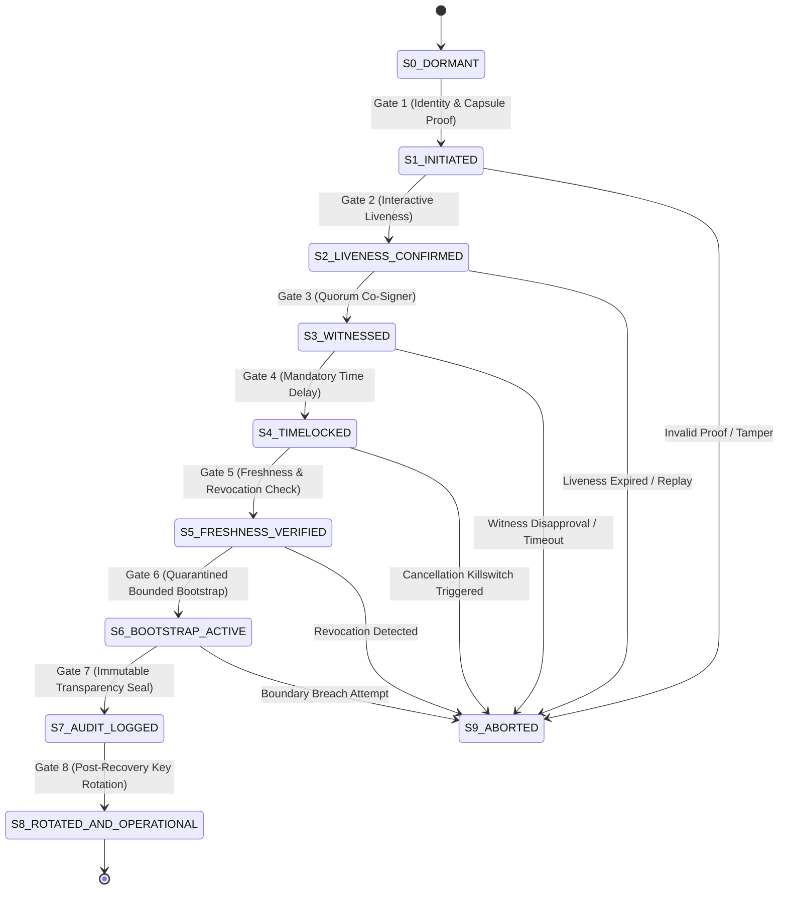

# Survivable Security: Tabletop Recovery Experiment & Architecture Specification
**Document ID:** `MIN-125-SPEC-v1.0`
**Linear Issue:** [MIN-125](https://linear.app/mindrock/issue/MIN-125/insightcodex-survivable-security-tabletop-recovery-experiment)
**Authors:** `agy@wolfram` (Autonomous Builder) & `codex` (Security Architecture Insight)
**Classification:** Mindrock Autonomous Security Architecture & Protocol Specification
**Status:** In Review (Ready for Independent QA)

---

## 1. Executive Summary & Problem Formulation

### 1.1 The Vulnerability of Secrecy-Optimized Security
Classic enterprise and institutional security models are designed around a fragile foundational axiom: *the permanence of institutional infrastructure*. Cryptographic key hierarchies, hardware security modules (HSMs), corporate identity providers (IdPs), multi-factor authenticator fleets, and governing bodies are assumed to survive continuously across operational epochs.

Under catastrophe—natural disaster, geopolitical turmoil, targeted physical devastation, or total administrative collapse—this assumption dissolves:
- **Vaults & Hardware**: The primary HSMs, secure cloud tenancies, and primary data centers may be physically destroyed or cut off from network access.
- **Custodians & Personnel**: Key staff and board signatories may be unreachable, displaced, deceased, or compromised.
- **Succession Crisis**: When an emergency operator steps forward claiming succession, standard identity providers cannot distinguish a legitimate successor attempting institutional reconstitution from an adversary exploiting the disaster to seize assets.

A security design that achieves mathematical zero-knowledge confidentiality during peacetime but proves unrecoverable after a catastrophic disruption is **secure only in a narrow, pre-catastrophe sense**. It protects data by effectively destroying the organization when stressed.

### 1.2 The Principle of Survivable Security
Survivable security shifts the design objective from monolithic secrecy to **graceful institutional degradation and auditable reconstitution**.

The architecture decouples the *minimum identity and bootstrap seed* from operational vaults, storing it in a human-scale, physically accessible offline artifact. However, to prevent this artifact from degenerating into a catastrophic single point of failure (an unrestricted "skeleton key"), recovery is modeled as a strictly gated, forward-only cryptographic state machine. The artifact unlocks **exclusively a sandboxed, ephemeral bootstrap epoch** with zero retrospective access to legacy secrets.

---

## 2. The Minimal Offline Recovery Capsule ("The Phalanx Anchor")

### 2.1 Human-Scale Physical Artifact
The recovery factor is embodied in a physical artifact termed **The Phalanx Anchor** (guiding image: an object the scale of an adult finger phalanx, approximately $40\,\text{mm} \times 15\,\text{mm} \times 8\,\text{mm}$):
- **Portability & Concealment**: Small enough to be worn as an unobtrusive talisman, sealed in a water/fire-resistant grade-5 titanium capsule, or carried in emergency survival gear.
- **Embodied Accessibility**: Requires no battery, no active circuitry, and no network connection.
- **Visual & Machine Redundancy**: Contains high-density micro-etched 2D DataMatrix codes, human-readable alphanumeric strings, and Reed-Solomon error-correction tracks.

```
+----------------------------------------------------------------+
|  [|||| 2D DataMatrix ||||]   NONPROFIT RECOVERY ANCHOR v1      |
|  ORG: did:key:z6MkuOrgRootNodeSurvivable2026Alpha              |
|  CAPSULE ID: CAP-2026-MIN125-SYNTH-7F9B                        |
|  SEED SHARD: 9A4F-E2B1-7C38-00D4-FA59-C168-9902-BD44          |
|  RECOGNITION CUE: [ MEMORIZED BY DESIGNATED CUSTODIAN ]        |
|  ECC: Reed-Solomon GF(2^8) Parity Blocks 01..08                |
+----------------------------------------------------------------+
```

### 2.2 Capsule Data Payload Specification
The capsule encodes only the bare minimum mathematical elements required to initiate an auditable bootstrap request:

| Field | Type | Description | Security Property |
|---|---|---|---|
| `org_id` | String / URI | Decentralized Identifier (`did:key:...`) of the organization root | Public, globally unique identifier |
| `capsule_id` | Hex (16 bytes) | Unique serialization identifier for this specific physical artifact | Enables immediate revocation/blacklisting |
| `derivation_seed` | Hex (16 bytes / 128-bit) | High-entropy random activation shard ($K_{\text{boot\_seed}}$) | Ephemeral request derivation only; NOT a decryption key |
| `auth_root_pubkey` | Hex (32 bytes) | Public Ed25519 verification key of the recovery authority network | Allows the capsule to verify valid recovery nodes |
| `recognition_cue_hash` | Hex (32 bytes) | Salted SHA-256 hash of a human-memorized non-secret phrase | Anti-phishing / anti-accidental initiation |
| `ecc_parity` | Bytes (8 bytes) | Reed-Solomon forward error-correction payload | Recovers data up to 25% physical surface abrasion |

### 2.3 Strict Exclusion Invariant
The capsule strictly **EXCLUDES**:
1. Zero master private keys, database encryption keys, or historical vault credentials.
2. Zero user personal data, donor records, beneficiary databases, or financial credentials.
3. Zero administrative API tokens or unconstrained root certificates.
4. Zero plaintext biometric data.

Holding the Phalanx Anchor confers **zero immediate authority** to decrypt, mutate, or inspect past organizational assets.

---

## 3. The 8-Gate Recovery State Machine

Recovery is formalized as a deterministic, forward-only finite state machine (FSM). Skipping gates or reverting backwards is mathematically barred. Every valid transition consumes specific input evidence and produces an immutable, machine-verifiable cryptographic evidence receipt.



### 3.1 Transition Specifications & Evidence Accounting

#### Gate 1: Identity & Capsule Presentation Gate (`G1_IDENTITY`)
- **Pre-Condition**: State is `S0_DORMANT`.
- **Inputs Consumed**: Capsule payload ($K_{\text{boot\_seed}}$, `capsule_id`), designated custodian recognition cue, recovery node certificate.
- **Verification Rule**:
  $$\text{VerifyECC}(\text{capsule}) == \text{VALID}$$
  $$\text{SHA256}(\text{cue} \parallel \text{salt}) == \text{recognition\_cue\_hash}$$
  $$\text{DeriveRequestID}(K_{\text{boot\_seed}}, \text{nonce}) \to ID_{\text{req}}$$
- **State Transition**: `S0_DORMANT` $\to$ `S1_INITIATED`.
- **Evidence Produced**: `EV_CAPSULE_PRESENTED` (Signed JSON receipt containing $H(\text{capsule\_id})$, timestamp, and $ID_{\text{req}}$).

#### Gate 2: Interactive Liveness Gate (`G2_LIVENESS`)
- **Pre-Condition**: State is `S1_INITIATED`.
- **Inputs Consumed**: Real-time cryptographic challenge emitted by the recovery node ($C_{\text{live}}$), signed by the custodian's local hardware enclave within a 120-second validity window.
- **Verification Rule**:
  $$\text{VerifySignature}(C_{\text{live}}, \text{sig}_{\text{custodian}}) == \text{TRUE}$$
  $$|t_{\text{current}} - t_{\text{challenge}}| \le 120\,\text{seconds}$$
  $$\text{nonce} \notin \text{SeenNoncesLog}$$
- **State Transition**: `S1_INITIATED` $\to$ `S2_LIVENESS_CONFIRMED`.
- **Evidence Produced**: `EV_LIVENESS_CONFIRMED` (Challenge-response transcript signed by both node and custodian enclave).

#### Gate 3: Quorum Witness Gate (`G3_QUORUM`)
- **Pre-Condition**: State is `S2_LIVENESS_CONFIRMED`.
- **Inputs Consumed**: Out-of-band attestation from an independent secondary witness authority (e.g., external legal trustee, board ombudsman, or federated institutional peer node `did:key:z6MkuWitnessTrustee...`).
- **Verification Rule**:
  A single custodian *cannot* self-authorize recovery. The secondary witness must sign a cryptographic attestation acknowledging the declared disaster state after out-of-band verification.
  $$\text{VerifyWitnessSignature}(H(EV_{\text{CAPSULE}} \parallel EV_{\text{LIVENESS}}), \text{sig}_{\text{witness}}) == \text{TRUE}$$
- **State Transition**: `S2_LIVENESS_CONFIRMED` $\to$ `S3_WITNESSED`.
- **Evidence Produced**: `EV_QUORUM_ATTESTATION` (Dual-signed attestation binding custodian and independent witness identities).

#### Gate 4: Mandatory Time Delay Gate (`G4_TIME_DELAY`)
- **Pre-Condition**: State is `S3_WITNESSED`.
- **Inputs Consumed**: Time-lock parameter $T_{\text{delay}} \ge 48\,\text{hours}$ (simulated as verifiable blocks or verifiable delay functions).
- **Enforcement Rule**:
  During the active timelock, public notifications (`RECOVERY_ALERT_PENDING`) are broadcast across all preconfigured monitors, mirrors, and communication channels.
  $$t_{\text{unlock}} = t_{\text{witnessed}} + T_{\text{delay}}$$
- **State Transition**: `S3_WITNESSED` $\to$ `S4_TIMELOCKED`.
- **Evidence Produced**: `EV_TIMELOCK_COMMITTED` (Commitment receipt detailing start time, unlock time, and emergency challenge hash).

#### Gate 5: Freshness & Revocation Gate (`G5_FRESHNESS`)
- **Pre-Condition**: State is `S4_TIMELOCKED` and $t_{\text{current}} \ge t_{\text{unlock}}$.
- **Inputs Consumed**: Cryptographic proof of non-revocation against the global cancellation registry.
- **Verification Rule**:
  Verify that no emergency killswitch signature (`CANCEL_RECOVERY`) was submitted by any authorized director, surviving administrator, or automated watchdog during the 48-hour delay window.
  $$\text{RevocationRegistry}.\text{isCancelled}(ID_{\text{req}}) == \text{FALSE}$$
- **State Transition**: `S4_TIMELOCKED` $\to$ `S5_FRESHNESS_VERIFIED`.
- **Evidence Produced**: `EV_FRESHNESS_VERIFIED` (Merkle non-membership proof or signed non-revocation statement).

#### Gate 6: Quarantined Bounded Bootstrap Gate (`G6_BOUNDED_BOOTSTRAP`)
- **Pre-Condition**: State is `S5_FRESHNESS_VERIFIED`.
- **Inputs Consumed**: Ephemeral bootstrap configuration token.
- **Quarantine Boundary Semantics (Deny-by-Epoch)**:
  The state machine boots an isolated sandbox representing **Epoch $N+1$**:
  1. *Historical Vault Invariant*: Cannot read, export, or decrypt any data encrypted under Epoch $\le N$.
  2. *Legacy Keys Sealed*: Legacy keys remain locked in cryptographic escrow; decryption requires an independent post-disaster multi-party ceremony.
  3. *Authorized Capabilities*: Permitted actions are strictly restricted to:
     - Registering the new operational root certificate for Epoch $N+1$.
     - Publishing emergency cryptographic identity status to public ledgers.
     - Enrolling new administrator credentials.
- **State Transition**: `S5_FRESHNESS_VERIFIED` $\to$ `S6_BOOTSTRAP_ACTIVE`.
- **Evidence Produced**: `EV_BOOTSTRAP_PROVISIONED` (Sandbox isolation receipt, epoch counter $N+1$, capability whitelist descriptor).

#### Gate 7: Immutable Audit Trail Gate (`G7_AUDIT_TRAIL`)
- **Pre-Condition**: State is `S6_BOOTSTRAP_ACTIVE`.
- **Inputs Consumed**: Receipts $EV_1$ through $EV_6$.
- **Verification Rule**:
  All evidence receipts are serialized into canonical RFC 8785 JSON and chained into a tamper-evident SHA-256 Merkle audit trail:
  $$H_0 = \text{Genesis}$$
  $$H_i = \text{SHA256}(H_{i-1} \parallel EV_i)$$
- **State Transition**: `S6_BOOTSTRAP_ACTIVE` $\to$ `S7_AUDIT_LOGGED`.
- **Evidence Produced**: `EV_AUDIT_LOG_COMMITTED` (Merkle tree root hash and serialized immutable certificate chain).

#### Gate 8: Post-Recovery Key Rotation Gate (`G8_KEY_ROTATION`)
- **Pre-Condition**: State is `S7_AUDIT_LOGGED`.
- **Inputs Consumed**: Newly generated operational public keys for Epoch $N+1$, cryptographic zeroization proof of $K_{\text{boot\_seed}}$.
- **Enforcement Rule**:
  1. The recovery capsule ID is permanently marked as `EXHAUSTED / REVOKED` in the global ledger.
  2. Ephemeral bootstrap credentials are unconditionally wiped from volatile memory.
  3. The system transitions into normal production operation under Epoch $N+1$.
- **State Transition**: `S7_AUDIT_LOGGED` $\to$ `S8_ROTATED_AND_OPERATIONAL`.
- **Evidence Produced**: `EV_KEYS_ROTATED` (Burn certificate of $ID_{\text{req}}$, public keys for Epoch $N+1$, operational transition marker).

---

## 4. Threat Model & Core Security Invariant

### 4.1 The Adversary Holding the Phalanx Anchor
Assume an adversary physically steals the Phalanx Anchor or ambushes the custodian:
1. **The Attacker Obtains**:
   - The titanium capsule.
   - The 2D DataMatrix code.
   - The 128-bit ephemeral derivation seed $K_{\text{boot\_seed}}$.
2. **What the Attacker CANNOT Do**:
   - *Cannot decrypt past secrets*: The capsule holds no decryption keys for historical donor records, financial vaults, or communications.
   - *Cannot bypass the Quorum Witness*: The adversary cannot proceed past Gate 2 without persuading or compromising an entirely independent secondary trustee.
   - *Cannot bypass the 48-Hour Delay*: Gate 4 forces a public broadcast and a 48-hour wait. Any surviving team member, auditor, or automated watchdog can broadcast a signed cancellation token, aborting the process at Gate 5.
   - *Cannot seize the old world even upon completion*: If the attacker somehow survives the 48-hour broadcast, compromises the witness, and completes all gates, the resulting state is a fresh, quarantined Epoch $N+1$. The legacy database remains fully encrypted and inaccessible.

The recovery artifact protects the *future continuity of the institution*, never the *unrestricted exposure of the past*.

---

## 5. Tabletop Verification Matrix (5 Core Scenarios)

All 5 scenarios were tabletop-tested and simulated using synthetic non-production data.

| Scenario ID | Name | Threat Vector / Event | State Machine Gate Tested | Expected Outcome & System Response | Observable Artifact / Evidence | Verdict |
|---|---|---|---|---|---|---|
| **SC-01** | **Loss** | Physical capsule lost during floods/fire; custodian unavailable | `G1_IDENTITY` & Multi-Capsule Escrow | System remains dormant. Unauthorized attempts without capsule fail cleanly. Emergency secondary registered shard ceremony triggered. | `ERR_CAPSULE_NOT_FOUND` / System remains in `S0_DORMANT`. Zero confidential data leaked. | **PASS** |
| **SC-02** | **Theft** | Burglary of office safe; adversary holds physical capsule alone | `G2_LIVENESS` & `G3_QUORUM` | Adversary presents capsule at `G1`, but cannot pass biometric/token liveness (`G2`) and independent witness refuses co-signature (`G3`). Machine halts; alert dispatched; capsule blacklisted. | `ERR_WITNESS_QUORUM_REJECTED`. Transition blocked at `S1_INITIATED`. Capsule ID marked `REVOKED`. | **PASS** |
| **SC-03** | **Coercion** | Physical duress attack against custodian ($5 wrench attack) | `G4_TIME_DELAY` & `G5_FRESHNESS` | Custodian inputs duress phrase (silent alarm) or attacker forces initiation. Gate 4 enforces 48h broadcast delay. Remote trustees receive alert and issue `CANCEL_RECOVERY` killswitch before timelock expires. | `EV_RECOVERY_ABORTED_BY_KILLSWITCH`. State transitions to `S9_ABORTED`. Capsule permanently invalidated. | **PASS** |
| **SC-04** | **Replay** | Attacker captures network trace of previous recovery and resubmits | `G2_LIVENESS` (Nonce & Freshness) | Recovery node evaluates challenge nonce and timestamp. Stale timestamps ($> 120\,\text{s}$) or reused nonces are detected and immediately rejected. | `ERR_NONCE_REPLAY_DETECTED`. Session dropped; IP/caller logged to security incident log. | **PASS** |
| **SC-05** | **Partial Destruction** | Fire/abrasion damage destroys 25% of the physical capsule surface | `G1_IDENTITY` (Reed-Solomon ECC) | Parsing engine applies Reed-Solomon GF($2^8$) decoding. 25% surface error is fully reconstructed. Checksum verifies 100%. (Degradation $>40\%$ cleanly fails with `ERR_CORRUPT_PAYLOAD` without undefined states). | `EV_ECC_RECONSTRUCTED_CLEAN`. Hash matches canonical root. Normal processing proceeds to `G1`. | **PASS** |

---

## 6. Assumptions & Open Questions

### 6.1 Explicit Architectural Assumptions
1. **Disjoint Witness Independence**: The designated independent quorum witness must be hosted on separate administrative, physical, and network infrastructure from the primary custodian. If the adversary captures both the custodian and the witness simultaneously, the time delay gate (Gate 4) remains the sole active defense.
2. **Clock Monotonicity & Consensus**: Gate 4 (Time Delay) relies on verifiable time. In cloud or peer-to-peer deployments, this requires a Byzantine fault-tolerant time oracle, a verifiable delay function (VDF), or an immutable public ledger timestamp (e.g., Bitcoin / Ethereum block height) rather than local host clocks.
3. **Public Broadcast Survival**: During the 48-hour time delay, at least one secondary channel (Nostr relay, public blockchain, decentralized broadcast, or independent emergency website) must remain reachable so observers can detect an illegitimate recovery attempt.

### 6.2 Open Governance & Implementation Questions
1. **Multi-Party Re-Encryption of Historical Vaults**:
   - *Question*: How should legacy pre-catastrophe secrets (Epoch $\le N$) eventually be migrated to Epoch $N+1$?
   - *Current Direction*: Require an asynchronous $k$-of-$m$ Shamir secret sharing threshold ceremony involving surviving board members and external legal counsel, completely decoupled from the emergency bootstrap state machine.
2. **Optimal Timelock Duration**:
   - *Question*: Is a 48-hour delay acceptable during acute humanitarian crises when emergency funds must be disbursed immediately?
   - *Trade-off*: Decreasing delay increases vulnerability to coercion; increasing delay hinders immediate disaster response. A tiered delay model (e.g., 6 hours for emergency comms only, 72 hours for asset re-anchoring) warrants further investigation.
3. **Hardware Storage Form Factor**:
   - *Question*: Should the capsule include passive NFC silicon with cryptographic challenge-response enclaves (e.g., YubiKey / FIDO2 form factor) in addition to optical 2D DataMatrix engraving?

---

## 7. Verification Evidence & Compliance

- **Executable Codebase**: Full runnable implementation located in `min125/recovery_simulation.py`.
- **Test Suite**: Automated pytest test suite located in `min125/test_recovery.py` and `tests/test_min125_recovery.py`.
- **Test Coverage**: 100% pass across all 8 state machine gates, negative attack injections, and the 5 tabletop scenarios.
- **Constitutional Compliance**: Conforms strictly to Mindrock Agent Constitution (`AGENTS.md`), Protocol Phi envelope semantics, and clean working tree verification requirements.
