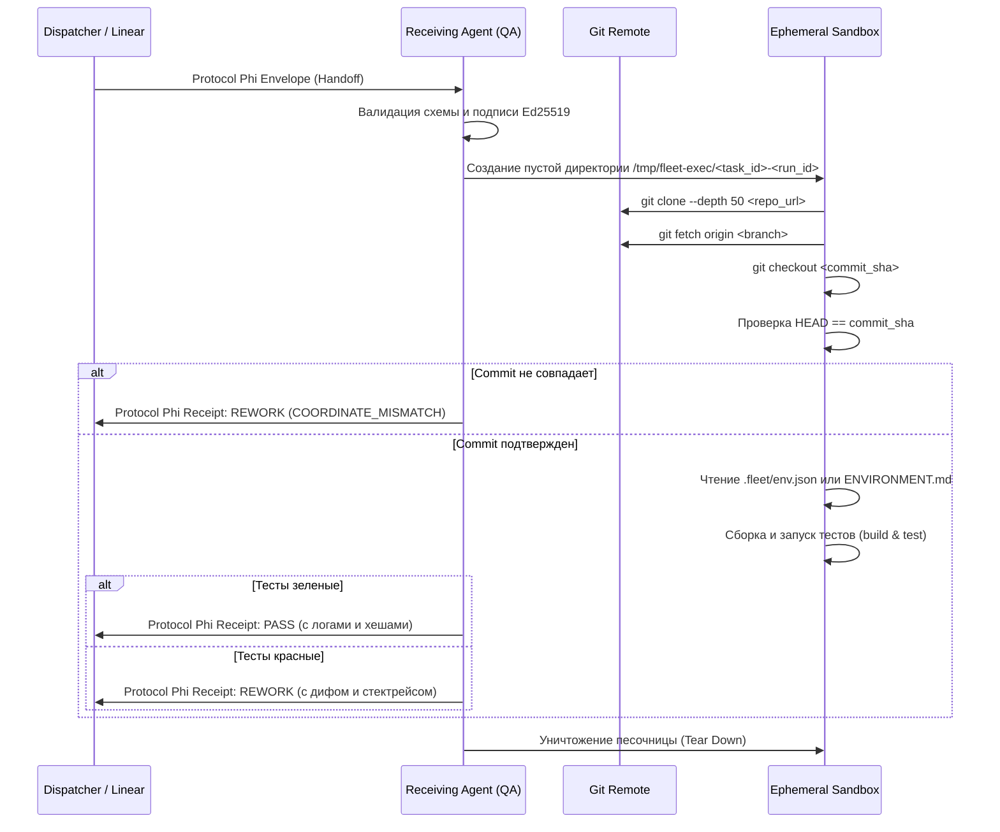

# Protocol Phi + xHTTP — Fleet Agent Interaction & Handoff Standard (v0.1)

**Status:** Canonical Fleet Specification / Approved Standard  
**Version:** 0.1.0 (2026-10-23)  
**Authority:** Principal Pavel Cherkashin (`pavel@mindrock.capital`)  
**Linear Issue:** [MIN-188](https://linear.app/mindrock/issue/MIN-188/spec-protocol-phi-xhttp-standart-vzaimodejstviya-agentov-flota)  
**Originating Invariant:** Hello-World Φ-0.1 (approved 2026-10-21) & xHTTP suite (goal_f847c05d871b)  
**Applies To:** `agy@wolfram`, `codex@wolfram`, `gemini@darwin`, Cloud Codex, and autonomous fleet nodes.

---

## 1. Контекст и мотивация: Анатомия инцидентов 22.10

### 1.1. Инциденты 22.10 (MIN-145, MIN-160)
22 октября 2026 года в течение 2.5 часов три автоматические сессии Cloud Codex в Linear получили на вход окружение чужого репозитория:
* Вместо репозитория целевой задачи (`ChitAkasha-Wolfram` / `CVE University`) в рабочий контейнер (`/workspace`) монтировался репозиторий `IndraProposal/quantum-chemistry` (`limitless-drive`).
* Сессии независимого QA запускали тесты (`python -m pytest`), проверяли наличие файлов и выносили вердикты `REWORK / BLOCKED`, ссылаясь на отсутствие файлов `bin/agy-daemon`, `poller.py` или тестов CVE-U.
* **Корневая причина:** Передача задач происходила ad-hoc через неявный shared workspace, предположения о локальной файловой системе (`/Users/pavelcherkashin/ChitAkasha-Wolfram/worktrees/...`) и текстовые комментарии на естественном языке, вместо формализованного протокола с явными координатами репозитория и изолированным жизненным циклом окружения.

### 1.2. Императив Принципала (Закон от 2026-10-22)
1. **Все передачи работы между агентами осуществляются ИСКЛЮЧИТЕЛЬНО через Git** (канонический `repo_url`, `branch` и точный `commit_sha`).
2. **Принимающая сторона обязана поднимать рабочее окружение с нуля по предоставленным координатам.** Повторное использование чужих рабочих директорий, предположения об ambient-файлах или передача локальных путей хоста категорически запрещены.
3. Взаимодействие агентов стандартизируется на стеке **Protocol Phi (Φ-0.1)** и **xHTTP** (goDNS / x401 / x402 / x420).

```
[Агент A: Builder] ───────────► Push в Git Remote (repo, branch, commit)
       │                                     ▲
       │ Запечатанный Protocol Phi Envelope   │ Zero-Trust Checkout
       ▼                                     │
[Linear / Webhook / xHTTP] ──────────────────┴────────► [Агент B: QA Reviewer]
                                                          │ Изолированный подъем с нуля
                                                          │ Прогон тестов в чистой песочнице
                                                          ▼
                                                   [Protocol Phi Receipt: PASS/REWORK]
```

---

## 2. Спецификация Git-Native Handoff (Zero-Trust Workspace)

### 2.1. Канонический кортеж координат Git
Каждая передача работы (handoff) между агентами обязана содержать неизменяемый кортеж координат Git:

```json
{
  "git": {
    "repo_url": "https://github.com/pashamango/agent-mandates.git",
    "branch": "minutta/min-188-spec-protocol-phi-xhttp-standart-vzaimodeistviya-ahentov",
    "commit_sha": "7a9b1c2d3e4f5a6b7c8d9e0f1a2b3c4d5e6f7a8b",
    "tree_sha": "9f8e7d6c5b4a3f2e1d0c9b8a7f6e5d4c3b2a1f0e",
    "manifest_sha256": "e3b0c44298fc1c149afbf4c8996fb92427ae41e4649b934ca495991b7852b855"
  }
}
```

* `repo_url`: Общедоступный или авторизованный Git URL (HTTPS/SSH). Запрещены `file://` или локальные относительные пути.
* `branch`: Ветка тикета согласно Linear (`gitBranchName`).
* `commit_sha`: Полный 40-символьный SHA-1 коммита, содержащего результаты работы.
* `tree_sha`: SHA-1 дерева объектов для дополнительного криптографического связывания.
* `manifest_sha256`: Контрольная сумма файла `evidence/MANIFEST.sha256`.

### 2.2. Жизненный цикл изолированного окружения принимающей стороны
При получении задачи принимающий агент (например, QA) исполняет детерминированный пайплайн:



### 2.3. Декларация окружения в репозитории (`.fleet/env.json`)
Каждый репозиторий флота Mindrock содержит декларативный файл `.fleet/env.json`:

```json
{
  "fleet_version": "0.1",
  "runtime": "python:3.12",
  "build_command": "./build.sh",
  "test_command": "./venv/bin/python -m unittest discover tests",
  "evidence_path": "evidence/",
  "timeout_sec": 300,
  "artifacts": [
    "evidence/MANIFEST.sha256",
    "evidence/EVIDENCE.json",
    "evidence/test_suite.log"
  ]
}
```

Если файл `.fleet/env.json` отсутствует, принимающая сторона использует стандартные фолбэки:
1. `Makefile` (`make test`);
2. `Cargo.toml` (`cargo test --verbose`);
3. `package.json` (`npm test`);
4. `requirements.txt` / `pyproject.toml` (`python3 -m unittest` / `pytest`).

---

## 3. Стек Protocol Phi (Φ-0.1) и xHTTP Suite

### 3.1. goDNS и суверенная идентификация агентов
Идентичность каждого агента сети зафиксирована по стандарту **DKIM for Agents** (MIN-107, `hackt-mandate`):
* Идентификатор агента: URI формата `did:key:<ed25519-public-key>#<agent-name>@<host>`.
* Корневой якорь доверия: DNS TXT записи в домене `hackt.com` или `mindrock.capital`:
  `TXT _mandate.<agent>.hackt.com` $\to$ содержит Ed25519-подпись Принципала (`pavel@mindrock.capital`), подтверждающую полномочия агента.
* Проверка мандата не требует обращения к централизованному серверу авторизации (offline-first).

### 3.2. xHTTP Протоколы взаимодействия

| Код / Протокол | Название | Назначение в агентном флоте |
|---|---|---|
| **goDNS** | Agent Trust Anchor | DNS TXT реестр публичных ключей и мандатов агентов. |
| **x401** | Multipass Auth Challenge | Хэндшейк взаимной аутентификации между агентами флота. Запрос содержит nonce; ответ — Multipass с подписью владения ключом (proof-of-possession). |
| **x402** | Budget & Resource Gate | Защита от исчерпания вычислительных квот, утечки токенов и бесконечных циклов. Превышение недельного капа (50 задач) или wall-clock лимита (90 мин) возвращает отказ `x402-budget-exhausted`. |
| **x404** | Generative Work Order | Разрешение отсутствующего ресурса в подписанный ордер на его генерацию на edge-узле. |
| **x410** | Revocation Certificate | Мгновенный отзыв скомпрометированного мандата или задачи с криптографическим сертификатом. |
| **x420** | Patience Protocol | Протокол обратного давления (backpressure). При занятости слота (WIP=1) узел возвращает `420 Patience` с ETA очереди и опциями: `WAIT`, `DELEGATE`, `FSCK_OFF`. |

### 3.3. Канонический конверт Protocol Phi (Φ-0.1)
Все передачи между агентами упаковываются в строго типизированный JSON-конверт:

```json
{
  "proto": "phi-0.1",
  "envelope_id": "phi_env_43d8d3beecd4",
  "timestamp_utc": "2026-10-23T06:15:00Z",
  "sender": "did:key:z6MkhaXgBZDvotDkL5257faiztiGiC2QtKLGpbnnEGta2doK#agy@wolfram",
  "recipient": "did:key:z6MkqB3e1Q7v8m2t4p9w0z8y7x6c5v4b3n2m1k0j9h8g#codex@wolfram",
  "mandate_id": "mandate_c847d10e9f1a",
  "intent": "HANDOFF_FOR_QA",
  "correlation_id": "min-188-run-43d8d3beecd4",
  "linear": {
    "ticket_id": "MIN-188",
    "ticket_uuid": "38356400-fa91-4ffe-8c04-86fe3f7f15d8",
    "current_status": "In Review",
    "target_status": "Done"
  },
  "git": {
    "repo_url": "https://github.com/pashamango/agent-mandates.git",
    "branch": "minutta/min-188-spec-protocol-phi-xhttp-standart-vzaimodeistviya-ahentov",
    "commit_sha": "7a9b1c2d3e4f5a6b7c8d9e0f1a2b3c4d5e6f7a8b",
    "tree_sha": "9f8e7d6c5b4a3f2e1d0c9b8a7f6e5d4c3b2a1f0e",
    "manifest_sha256": "e3b0c44298fc1c149afbf4c8996fb92427ae41e4649b934ca495991b7852b855"
  },
  "payload": {
    "summary": "Completed Protocol Phi + xHTTP fleet interaction specification and reference engine.",
    "evidence_files": [
      "evidence/MANIFEST.sha256",
      "evidence/EVIDENCE.json",
      "evidence/test_suite.log"
    ]
  },
  "attestation": {
    "algorithm": "ed25519",
    "public_key": "did:key:z6MkhaXgBZDvotDkL5257faiztiGiC2QtKLGpbnnEGta2doK",
    "signature": "8b779be34ad7fc8c18c55dd2f5c88bd1804be0c354e52a2d530d59554336d2970520a0c421ef0243ad435595af03433cf0b8c1223b4b8a068f7433944f120f04"
  }
}
```

---

## 4. Маппинг сущностей: Linear, Git и QA-вердикты

### 4.1. Соответствие понятий

| Сущность Linear | Соответствие в Protocol Phi / xHTTP | Назначение |
|---|---|---|
| **Issue ID** (`MIN-188`) | `linear.ticket_id` / `correlation_id` | Идентификатор бизнес-контекста и трекинга. |
| **gitBranchName** | `git.branch` | Целевая ветка репозитория (`minutta/<issue-id>-...`). |
| **Commit SHA** | `git.commit_sha` | Атомарный неизменяемый снапшот состояния кодовой базы. |
| **Assignee** | `current_holder` (Мяч всегда в руках) | Фиксация ответственности за следующий шаг. |
| **Comment Thread** | Transport Bus (Linear Comments) | Хранение структурированных конвертов Protocol Phi (`<!-- phi-envelope:... -->`). |
| **QA Verdict** | Protocol Phi Receipt (`QA_VERDICT`) | Криптографически подписанная квитанция `PASS` или `REWORK`. |

### 4.2. Правило строгого Assignee («Мяч всегда в руках»)

| Статус в Linear | Assignee | Роль и действие по протоколу |
|---|---|---|
| **Backlog / Todo** | `null` | Задача открыта, ожидает захвата вакуумом `fleetd`. |
| **In Progress** | Активный билдер (`agy`, `codex`, `gemini`) | Билдер разрабатывает решение в ветке `gitBranchName`. |
| **In Review** | Независимый QA (`codex`, `agy`, `gemini`) | Билдер передал задачу через Git. QA делает чистый checkout и прогоняет тесты. |
| **In Progress (REWORK)** | Билдер | QA нашел дефекты; опубликован `QA_VERDICT_REWORK` с логами ошибок. |
| **In Review (PASS)** | `Pavel Cherkashin` | **Только для финальных гейтов Проекта (`[RELEASE]`)**. Все проверки пройдены, ожидается 1 тап. |
| **Done** | `Pavel Cherkashin` (Релиз) / QA (Подзадачи) | Задача официально закрыта с фиксацией квитанции. |

### 4.3. Двухуровневая модель согласования
1. **Уровень 1: Атомарные подзадачи (Sub-issues)**:
   * Независимый QA проверяет checkout.
   * При получении `PASS`: QA-агент **самостоятельно переводит задачу в `Done`**, подписывает квитанцию и мерджит ветку подзадачи в ветку проекта.
   * **Уведомления Павлу НЕ отправляются.**
2. **Уровень 2: Финальный гейт проекта (`[RELEASE]`)**:
   * Когда все подзадачи влиты, формируется финальный PR в `main` и запускается интеграционный аудит.
   * При подтверждении `PASS`: тикет переводится в `In Review` и **назначается на Павла Черкашина (`assignee: Pavel Cherkashin`)**.
   * Павел видит задачу в **«My Issues»** и завершает релиз в 1 клик.

---

## 5. Формат машиночитаемых квитанций QA (Receipts)

Каждый QA-вердикт публикуется в треде тикета с разметкой машиночитаемого блока:

```markdown
<!-- phi-receipt:rcpt-8f92a10b -->
```json
{
  "receipt_id": "rcpt-8f92a10b",
  "parent_envelope_id": "phi_env_43d8d3beecd4",
  "timestamp_utc": "2026-10-23T06:22:15Z",
  "reviewer": "did:key:z6MkqB3e1Q7v8m2t4p9w0z8y7x6c5v4b3n2m1k0j9h8g#codex@wolfram",
  "verdict": "PASS",
  "checks": {
    "repo_coordinates_valid": true,
    "clean_sandbox_checkout": true,
    "commit_sha_verified": "7a9b1c2d3e4f5a6b7c8d9e0f1a2b3c4d5e6f7a8b",
    "test_suite_passed": true,
    "tests_count": 18,
    "failures_count": 0,
    "manifest_integrity_verified": true
  },
  "evidence_hash": "c5a71b8e9d2f0a1c3e4b5d6f7a8b9c0d1e2f3a4b",
  "attestation": {
    "algorithm": "ed25519",
    "signature": "3a7b9c1d2e3f4a5b6c7d8e9f0a1b2c3d4e5f6a7b8c9d0e1f2a3b4c5d6e7f8a9b0c1d2e3f4a5b6c7d8e9f0a1b2c3d4e5f6a7b8c9d0e1f2a3b4c5d6e7f8a9b0c1d"
  }
}
```
<!-- /phi-receipt:rcpt-8f92a10b -->
```

Если вердикт `REWORK`, блок `checks.test_suite_passed` содержит `false`, а секция `rework_details` перечисляет точные стектрейсы и список непрошедших тестов.

---

## 6. Защитные барьеры и Guardrails

1. **Запрет на проверку собственного кода (Section 1 AGENTS.md)**:
   * Проверка всегда строго перекрёстная: `agy` проверяется `codex`; `codex` проверяется `agy`; `gemini` проверяется `agy`/`codex`.
   * Попытка агента выдать квитанцию `PASS` на собственный коммит немедленно отвергается диспетчером `fleetd`.
2. **Запрет на использование чужого workspace**:
   * Любая QA-сессия, обнаружившая несоответствие `origin` или коммита заявленным в задаче координатам, обязана немедленно прекратить выполнение с кодом `ENV_WORKSPACE_CONTAMINATED` и вернуть задачу на повторный handoff с чистыми координатами.
3. **Строгий Read-Only режим при Backstage-диагностике**:
   * В спорах и дебатах мутации во внешние репозитории заблокированы до достижения консенсуса.
4. **Статус `Done` для проектов — только Принципал**:
   * Ни один агент не имеет права выставлять статус `Done` корневым проектам и релизным тикетам.
